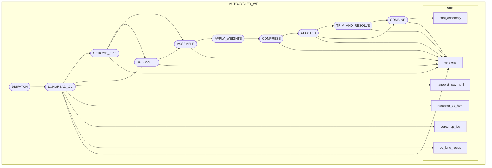

[](https://www.nextflow.io/)
[](https://www.docker.com/)
[](https://sylabs.io/docs/)


## Original Autocycler wrapper script by Ryan Wick [available here](https://github.com/rrwick/Autocycler/blob/main/pipelines/Automated_Autocycler_Bash_script_by_Ryan_Wick/autocycler_full.sh)

> [!NOTE]
> Please remember to properly cite Autocycler and the underlying tools it relies on when publishing results generated with this pipeline


```
nextflow wrapper for `Autocycler` genome assembly pipeline

Usage:
     nextflow run main.nf -profile docker --input samplesheet.csv --outdir PATH
Input:
     --input         : path to input sample sheet (CSV format)
     --outdir        : path to output directory
     --read_type     : read type (ont_r9, ont_r10, pacbio_clr, pacbio_hifi) [default: ont_r10]
     --skip_qc       : skip long read qc/qa steps
     --skip_nanoplot : skip nanoplot
     --skip_porechop : skip porechop
"""
```
## tl;dr
```bash
nextflow run main.nf \
  -profile singularity,drac \
  --input ./tests/data/samplesheet_test.csv \
  --outdir ./tests/outdir
```

## software dependencies

* [Nextflow](https://www.nextflow.io/)
* [Docker](https://www.docker.com/) or [Apptainer (Singularity)](https://apptainer.org/)

## usage
select :
  1) a container engine : docker or apptainer/singularity. Most HPC environment have apptainer already installed. Docker is mostly used on local workstations.
  2) a workload capacity : test, base or drac. test is for testing your installation. base is for running the pipeline as a single task, like on a local computer. drac is for running with the slurm executor on the Digital Research Alliance of Canada clusters or similar slurm-based HPC.

These profiles can be edited in [nextflow.config](./nextflow.config).

```bash
nextflow run main.nf \
  -profile {docker/singularity/apptainer},{test,base,drac} \
  --input ./tests/data/samplesheet_test.csv \
  --outdir ./tests/outdir
```

## sample sheet specification

The pipeline uses a CSV sample sheet to manage input data.  

The CSV must contain exactly **4 columns** with the following headers:

| column | description |
| --- | --- |
| sample_id | unique name for the sample. |
| long_reads | path to long-read FASTQ file.|
| short_reads_1 | path to post-qc forward R1 FASTQ file. |
| short_reads_2 | path to post-qc reverse R2 FASTQ file. |

> [!NOTE]
> 2026-06-09: short reads polishing is not yet implemented.

### input example
```csv
sample_id,long_reads,short_reads_1,short_reads_2
test1,tests/data/test1_reads_ont_r10.fastq.gz,,
test2,tests/data/test2_reads_ont_r10.fastq.gz,,
```

## acknowledgement
The structure of the pipeline tries to follow [__nf-core__](https://pubmed.ncbi.nlm.nih.gov/32055031) best practices :  
>Ewels PA, Peltzer A, Fillinger S, Patel H, Alneberg J, Wilm A, Garcia MU, Di Tommaso P, Nahnsen S. The nf-core framework for community-curated bioinformatics pipelines. Nat Biotechnol. 2020 Mar;38(3):276-278. doi: 10.1038/s41587-020-0439-x. PubMed PMID: 32055031.


