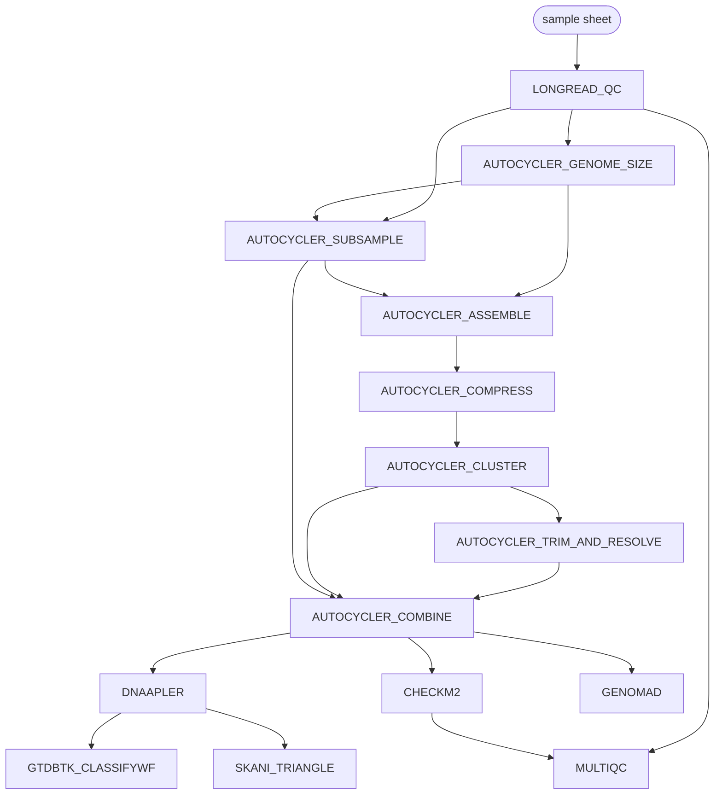

# dsamoht/isolate-wf: Output

## Introduction

This document describes the output produced by the pipeline. Results are organised by
sample: every directory below sits under `<outdir>/sample_<sample_id>/`, except the MultiQC
report and the pipeline information, which are global.

## Pipeline overview

- [Read QC](#read-qc) — NanoPlot, Porechop_ABI, Chopper
- [Consensus assembly](#consensus-assembly) — Autocycler
- [Reorientation](#reorientation) — Dnaapler
- [Assembly quality](#assembly-quality) — CheckM2
- [Mobile genetic elements](#mobile-genetic-elements) — geNomad
- [Taxonomy](#taxonomy) — GTDB-Tk, with `--run_gtdbtk`
- [Duplicate isolates](#duplicate-isolates) — skani, with `--run_dedup`
- [Sample summary](#sample-summary)
- [Run summary](#run-summary)
- [MultiQC](#multiqc)
- [Pipeline information](#pipeline-information)

### Read QC

Output files

- `sample_<sample_id>/reads/post_qc/`
  - `*.choppered.fastq.gz`: reads after adapter removal and length/quality filtering.
- `sample_<sample_id>/quality_assessment/nanoplot/raw/`
  - `*.html`: read length and quality report before trimming.
- `sample_<sample_id>/quality_assessment/nanoplot/post_qc/`
  - `*.html`: the same report after trimming.
- `sample_<sample_id>/quality_control/porechop/`
  - `*.porechop.log`: adapters found and removed.

Long reads are trimmed of adapters with Porechop_ABI, then filtered by length
(`--chopper_minlength`) and mean quality (`--chopper_minq`) with Chopper.

### Consensus assembly

Output files

- `sample_<sample_id>/autocycler_final/`
  - `consensus_assembly.fasta`: the Autocycler consensus assembly.
  - `consensus_assembly.gfa`: the consensus assembly graph, to inspect in [Bandage](https://rrwick.github.io/Bandage/).
  - `<sample_id>_autocycler_metrics.tsv`: the sample's Autocycler metrics, from `autocycler table`.
- `sample_<sample_id>/autocycler_clustering/`
  - `clustering.tsv`, `clustering.newick`, `clustering.yaml`: how the input contigs were clustered.
  - `assembly_filter.tsv`: the contig count of every input assembly and whether it was `kept`, `excluded` as an outlier, or `empty`, with the exclusion limit.
  - `<sample_id>_autocycler_out.tar.gz`: the whole Autocycler directory, as `autocycler_full.sh` would leave it: the input graph (`input_assemblies.gfa`), the `clustering/qc_pass/` and `qc_fail/` cluster directories with their untrimmed, trimmed and resolved graphs (`1_untrimmed.gfa` to `5_final.gfa`), and the consensus. For a sample whose clusters all fail QC, it stops at the untrimmed graphs.
- `autocycler_metrics.tsv`: the metrics of every sample in one table.

The genome size is estimated from the QC'd reads, the reads are split into subsets, and
every subset is assembled with every assembler not turned off with `--skip_<assembler>`. Autocycler compresses those assemblies into
a unitig graph, clusters the contigs into putative replicons, trims and resolves each
cluster that passes QC, and combines them into the consensus. A sample whose assemblers all
fail, or whose clusters all fail QC, gets no consensus: the run carries on and logs a warning.

`autocycler compress` stops a sample when its assemblies have more than 25 contigs on average
(`--max_contigs`). One assembler that keeps hundreds of low-coverage contigs, often metaMDBG,
Myloasm, Raven or miniasm, can push the average over that limit for an otherwise clean isolate.
To prevent this, the assemblies with more than five times the median contig count (and more than
25 contigs) are left out before compressing. Empty assemblies are left out as well, since
`autocycler compress` stops on an empty file, and they do not count towards the median.
The sample fails if fewer than half of its non-empty assemblies are left. `assembly_filter.tsv`
and the summary log list the assemblies that were left out. A sample whose assemblies are almost
all fragmented, because of low depth or a mixed culture, still fails: no filter can rescue it.
The thresholds are set in [usage](usage.md#outlier-assemblies).

The metrics tables help judge how much to trust a consensus: `pass_cluster_count` and
`fail_cluster_count` count the putative replicons kept and dropped, `overall_clustering_score`
measures how consistently the assemblies agree on them (1 is best), and
`consensus_assembly_fully_resolved` tells whether every replicon resolved to one contig. A
sample whose clusters all fail QC has no metrics line, but its clustering and archive are still
published. Extract the archive with `tar -xzf <sample_id>_autocycler_out.tar.gz` to open the
graphs in Bandage, or to re-run Autocycler on `autocycler_out/` from `autocycler cluster` on:
[the Autocycler wiki](https://github.com/rrwick/Autocycler/wiki) explains how to read the clusters
and curate them by hand.

### Reorientation

Output files

- `sample_<sample_id>/dnaapler/dnaapler_out/`
  - `<sample_id>_reoriented.fasta`: the consensus with its circular contigs starting at dnaA, repA or terL.

Only circular contigs are reoriented; linear ones are passed through unchanged.
Skipped with `--skip_dnaapler`.

### Assembly quality

Output files

- `sample_<sample_id>/checkm2/checkm2_out/`
  - `quality_report.tsv`: completeness and contamination of the consensus assembly.

Skipped with `--skip_checkm2`. An assembly under 90% completeness or over 5% contamination
(`--checkm2_min_completeness`, `--checkm2_max_contamination`) is flagged with a warning in its
summary log and in the run summary. High contamination in an isolate often means a mixed
culture.

### Mobile genetic elements

Output files

- `sample_<sample_id>/genomad/<sample_id>_summary/`
  - `*_plasmid_summary.tsv`, `*_virus_summary.tsv`: the contigs, or regions of contigs, classified as plasmid or virus, with their scores and the marker genes they carry.
  - `*_plasmid.fna`, `*_virus.fna`: their sequences.
  - `*_plasmid_genes.tsv`, `*_virus_genes.tsv`: the annotated genes of each plasmid and virus.
- `sample_<sample_id>/genomad/<sample_id>_find_proviruses/`
  - `*_provirus.tsv`: proviruses integrated in the chromosome, with their coordinates.

Skipped with `--skip_genomad`, or when no `--genomad_db` is given.

### Taxonomy

Output files

- `gtdbtk/gtdbtk_out/`: the GTDB-Tk `classify_wf` output for every sample of the run.
  - `gtdbtk.bac120.summary.tsv`, `gtdbtk.ar53.summary.tsv`: the classification of each genome, by domain. Each genome is named after its sample.

Run once, on the final assemblies of every sample (the reoriented ones, unless `--skip_dnaapler`),
only with `--run_gtdbtk` and `--gtdbtk_db`. The classification of each sample is also in its
summary log.

### Duplicate isolates

Output files

- `dedup/`
  - `skani_triangle.tsv`: the ANI and aligned fractions of every pair of final assemblies, from `skani triangle -E --slow`.
  - `duplicate_isolates.tsv`: the pairs with an ANI of at least 99.9% over at least 95% of both assemblies (`--dedup_min_ani`, `--dedup_min_af`), which are likely the same strain.

Run once on the final assemblies of every sample, only with `--run_dedup`. Two barcodes
that turn out to be the same strain are flagged with a warning in their summary logs and in
the run summary.

### Sample summary

Output files

- `sample_<sample_id>/`
  - `isolate-wf_sample_<sample_id>_summary.log`: what every step did for the sample, its key numbers, and the files it published.

The log starts with the outcome (the consensus, or why there is none), then has one
section per step, in the order they run: the reads kept by each QC step, the genome size and
read subsets, which assemblies produced contigs, the clusters kept, the consensus contigs and
whether they resolved, the gene each circular contig was reoriented to, the CheckM2
completeness and contamination, and the plasmids, viruses and proviruses geNomad found. A
step that was skipped says with which flag; one that was never reached says why. The
software versions of the run close it.

### Run summary

Output files

- `isolate-wf_run_summary.tsv`: one line per sample: `assembled` or `no_assembly`, the result line of its summary log, and its warnings.

With `--skip_failed_samples` (the default), a sample whose task fails stops there and the
other samples carry on. Its summary log says which step it stopped at, and the end of the run
lists the samples without a consensus and the flagged ones.

### MultiQC

Output files

- `multiqc/`
  - `multiqc_report.html`: NanoPlot, Porechop_ABI and CheckM2 results, and the software versions, in one report.

Skipped with `--skip_multiqc`.

### Pipeline information

Output files

- `pipeline_info/`
  - `execution_report_*.html`, `execution_timeline_*.html`, `execution_trace_*.txt`, `pipeline_dag_*.html`: Nextflow execution reports.
  - `isolate-wf_software_mqc_versions.yml`: the version of every tool used.

