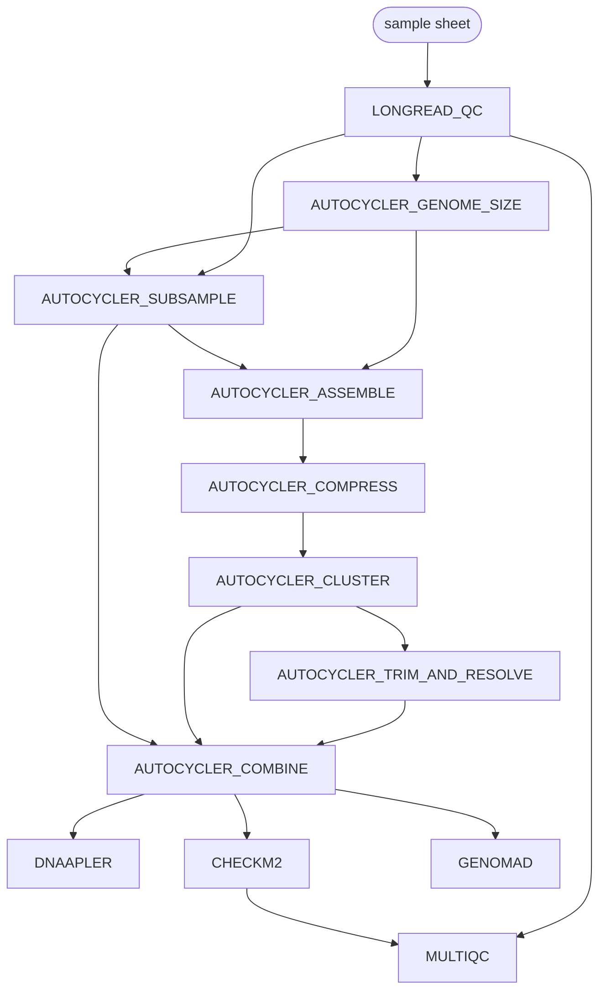

# dsamoht/isolate-wf: Output

## Introduction

This document describes the output produced by the pipeline. Results are organised by
sample: every directory below sits under `<outdir>/sample_<sample_id>/`, except the MultiQC
report and the pipeline information, which are global.

## Pipeline overview

- [Read QC](#read-qc) — NanoPlot, Porechop_ABI, Chopper
- [Consensus assembly](#consensus-assembly) — Autocycler
- [Reorientation](#reorientation) — Dnaapler
- [Assembly quality](#assembly-quality) — CheckM2
- [Mobile genetic elements](#mobile-genetic-elements) — geNomad
- [MultiQC](#multiqc)
- [Pipeline information](#pipeline-information)

### Read QC

Output files

- `sample_<sample_id>/reads/post_qc/`
  - `*.choppered.fastq.gz`: reads after adapter removal and length/quality filtering.
- `sample_<sample_id>/quality_assessment/nanoplot/raw/`
  - `*.html`: read length and quality report before trimming.
- `sample_<sample_id>/quality_assessment/nanoplot/post_qc/`
  - `*.html`: the same report after trimming.
- `sample_<sample_id>/quality_control/porechop/`
  - `*.porechop.log`: adapters found and removed.

Long reads are trimmed of adapters with Porechop_ABI, then filtered by length
(`--chopper_minlength`) and mean quality (`--chopper_minq`) with Chopper.

### Consensus assembly

Output files

- `sample_<sample_id>/autocycler_final/`
  - `consensus_assembly.fasta`: the Autocycler consensus assembly.
  - `consensus_assembly.gfa`: the consensus assembly graph, to inspect in [Bandage](https://rrwick.github.io/Bandage/).
  - `<sample_id>_autocycler_metrics.tsv`: the sample's Autocycler metrics, from `autocycler table`.
- `sample_<sample_id>/autocycler_clustering/`
  - `clustering.tsv`, `clustering.newick`, `clustering.yaml`: how the input contigs were clustered.
  - `<sample_id>_autocycler_out.tar.gz`: the whole Autocycler directory, as `autocycler_full.sh` would leave it: the input graph (`input_assemblies.gfa`), the `clustering/qc_pass/` and `qc_fail/` cluster directories with their untrimmed, trimmed and resolved graphs (`1_untrimmed.gfa` to `5_final.gfa`), and the consensus. For a sample whose clusters all fail QC, it stops at the untrimmed graphs.
- `autocycler_metrics.tsv`: the metrics of every sample in one table.

The genome size is estimated from the QC'd reads, the reads are split into subsets, and
every subset is assembled with every assembler not turned off with `--skip_<assembler>`. Autocycler compresses those assemblies into
a unitig graph, clusters the contigs into putative replicons, trims and resolves each
cluster that passes QC, and combines them into the consensus. A sample whose assemblers all
fail, or whose clusters all fail QC, gets no consensus: the run carries on and logs a warning.

The metrics tables help judge how much to trust a consensus: `pass_cluster_count` and
`fail_cluster_count` count the putative replicons kept and dropped, `overall_clustering_score`
measures how consistently the assemblies agree on them (1 is best), and
`consensus_assembly_fully_resolved` tells whether every replicon resolved to one contig. A
sample whose clusters all fail QC has no metrics line, but its clustering and archive are still
published. Extract the archive with `tar -xzf <sample_id>_autocycler_out.tar.gz` to open the
graphs in Bandage, or to re-run Autocycler on `autocycler_out/` from `autocycler cluster` on:
[the Autocycler wiki](https://github.com/rrwick/Autocycler/wiki) explains how to read the clusters
and curate them by hand.

### Reorientation

Output files

- `sample_<sample_id>/dnaapler/dnaapler_out/`
  - `<sample_id>_reoriented.fasta`: the consensus with its circular contigs starting at dnaA, repA or terL.

Only circular contigs are reoriented; linear ones are passed through unchanged.
Skipped with `--skip_dnaapler`.

### Assembly quality

Output files

- `sample_<sample_id>/checkm2/checkm2_out/`
  - `quality_report.tsv`: completeness and contamination of the consensus assembly.

Skipped with `--skip_checkm2`.

### Mobile genetic elements

Output files

- `sample_<sample_id>/genomad/<sample_id>_summary/`
  - `*_plasmid_summary.tsv`, `*_virus_summary.tsv`: the contigs, or regions of contigs, classified as plasmid or virus, with their scores and the marker genes they carry.
  - `*_plasmid.fna`, `*_virus.fna`: their sequences.
  - `*_plasmid_genes.tsv`, `*_virus_genes.tsv`: the annotated genes of each plasmid and virus.
- `sample_<sample_id>/genomad/<sample_id>_find_proviruses/`
  - `*_provirus.tsv`: proviruses integrated in the chromosome, with their coordinates.

Skipped with `--skip_genomad`, or when no `--genomad_db` is given.

### MultiQC

Output files

- `multiqc/`
  - `multiqc_report.html`: NanoPlot, Porechop_ABI and CheckM2 results, and the software versions, in one report.

Skipped with `--skip_multiqc`.

### Pipeline information

Output files

- `pipeline_info/`
  - `execution_report_*.html`, `execution_timeline_*.html`, `execution_trace_*.txt`, `pipeline_dag_*.html`: Nextflow execution reports.
  - `isolate-wf_software_mqc_versions.yml`: the version of every tool used.

